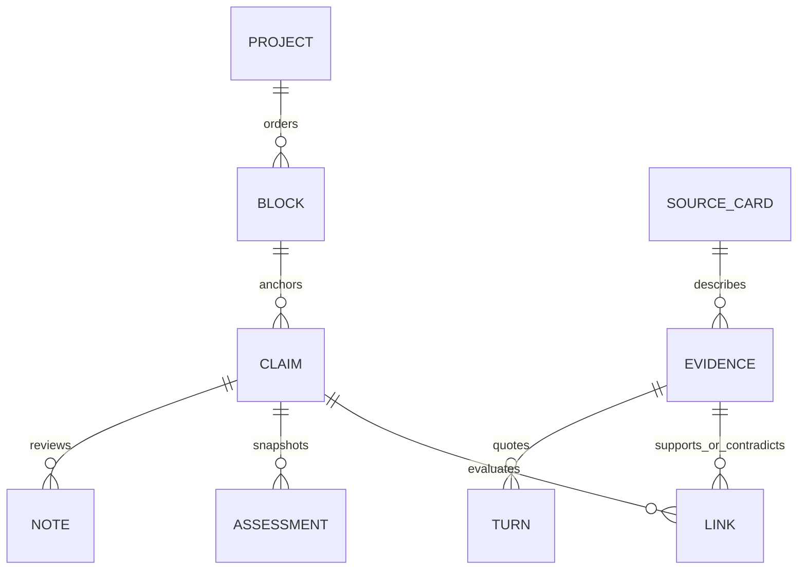

# 领域与本体设计

## 专业聚合与事实归属

SourceCard来源说明、Evidence固定引文、Turn采访原话、Block稿件段落、Claim文章主张、Link证据关系、Assessment核实记录、Note固定意见。一个专业工程内维护相关集合，避免为每个小对象建立数据库或独立服务。根字段为cards、evidence、turns、blocks、claims、links、assessments、notes、basis_refs。

作品、正式正文、设定、原始资料、素材和事务归宿主Core。专业对象及其固定修订属于本包；跨插件依据固定owner_plugin_id、object_id、revision和sha256。WorkRef区分小说、剧本、视频，同一名字、ID片段或目录不扩大授权。

## 不变量

Evidence固定原始source_index及UTF-8区间，原话和原件只追加、不覆盖。Turn关联明确说话人与固定引文。Claim固定段落摘要及原文锚点，改稿后显示待复核。Link区分支持、反证与背景；Assessment固定主张及证据组合摘要，只追加，证据关系或描述变化后显示过期。存在反证时不能记录为无争议支持；核实状态是记录者判断，不替代事实和作者决定。

所有集合ID在自身范围唯一；任何引用必须存在，顺序在各自父级内唯一。移除被引用项前先显式处理关系，整本保存也不能绕过原件和核实记录的历史保护。来源只追加，不能将已有索引改指另一份材料。

## 解释与作者决定

程序执行可重复规则，Agent解释与准备候选，作者保留取舍、采纳和定稿。专业状态只是检查依据；无法判断时保留缺口，不能用默认值掩盖。内容改变形成新专业修订，旧意见坐标和依据不静默移到新稿。
