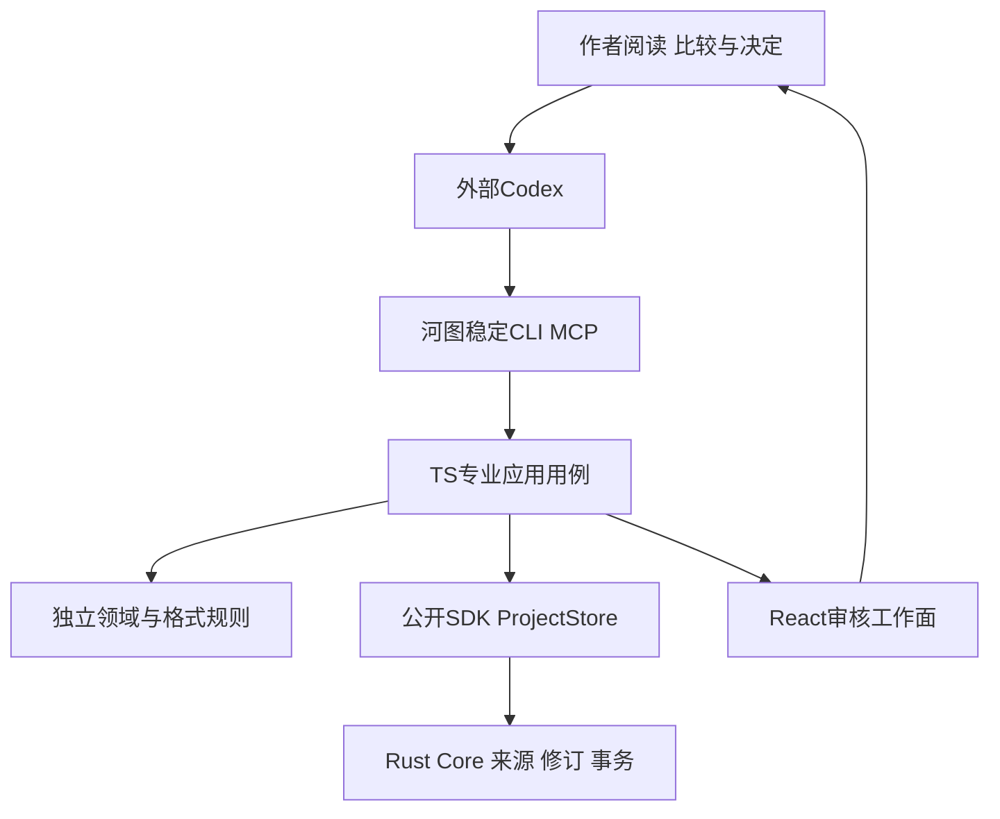

# 架构与技术选型

Citation.js把元数据、格式和渲染分层；Hypothesis保留目标与选区。河图使用不可变来源修订及UTF-8字节锚点，不依赖当前网页位置，也不复制云账户或浏览器批注权限系统。

KISS：一个专业聚合和一套CAS事务。DRY：作品、原件、素材、身份与固定引用复用Core。SOLID：领域、格式、应用、视图和分发单向依赖。YAGNI：只实现本批明确旅程，不建立搜索平台、权限体系、云协作、支付或模型调度器。

外部Agent负责理解与生成，本包负责可重复规则及专业成果，宿主负责事务与必要作者决定。CLI/MCP和GUI消费同一应用用例；GUI用于连贯审核，机器业务无需运行窗口。Cordis只属于宿主生命周期，专业包不用绑定其内部对象。

同一WorkRef的固定专业依据支持三包组合；引用不复制事实Owner，不传播权限与修订。插件技术栈与DSH相似不等于二进制或包格式兼容，按河图manifest、SDK和生命周期交付。
